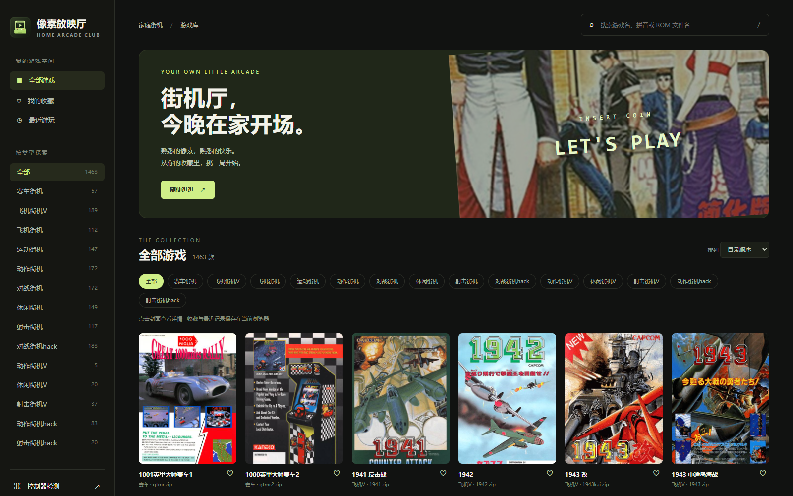
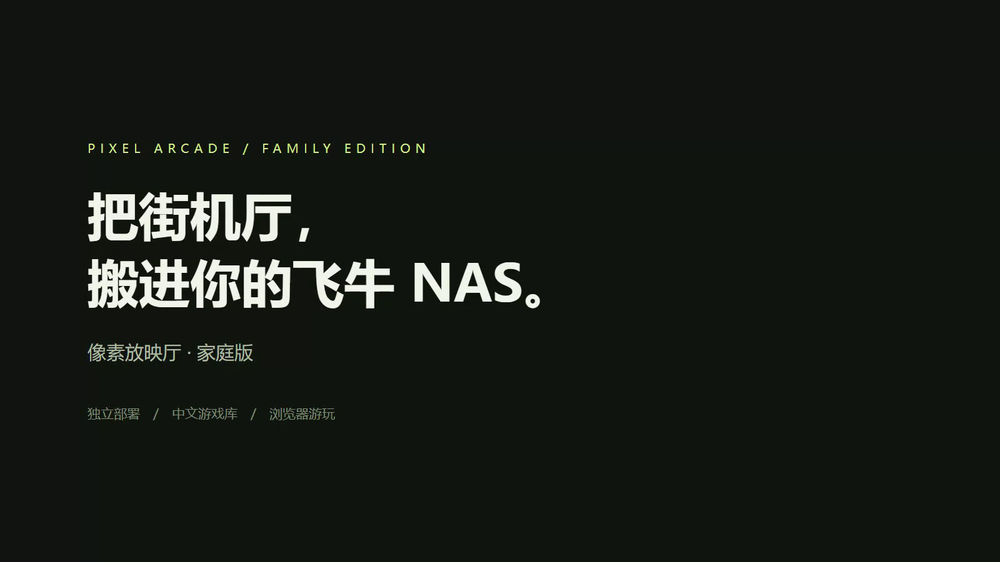

# 像素放映厅 · 家庭版

[](https://github.com/infinitytom/pixel-arcade-family/actions/workflows/check.yml)

**让你的飞牛 NAS，变成家里的街机游戏厅。**

v1.4.0：统一机台圆角玻璃与画面开口；新增可接入现有鉴权服务的账号同步模块，保存收藏、历史、画面设置与存档缩略图。家庭版默认仍为本机模式，账号服务接入见 [账号同步说明](docs/account-sync.md)。下载 [最新发布包](https://github.com/infinitytom/pixel-arcade-family/releases/latest)，已有安装请按 [更新部署指南](docs/update.md) 保留配置和数据。

[观看此前版本的更新演示（v1.1.2）](https://github.com/infinitytom/pixel-arcade-family/releases/download/v1.1.2/pixel-arcade-family-v1.1.2-update.mp4)

中文游戏库、分类搜索、封面与视频预览、收藏、最近游玩。打开浏览器即可游玩，无需续映账号。适合飞牛 fnOS，也可部署在能运行 Docker 的 Linux 主机上。



[飞牛图文部署教程](docs/fnos.md) · [资源与导入说明](docs/resources.md) · [常见问题](docs/faq.md) · [宣传视频](https://github.com/infinitytom/pixel-arcade-family/releases/latest) · [支持作者](#支持作者)

[](https://github.com/infinitytom/pixel-arcade-family/releases/latest)

宣传片采用实际界面录制与文字提示，配轻背景音乐，无配音和赞助码，成片、项目 ZIP 和发布说明见 Release。[验证记录](docs/verification.md)记录了已测范围和待验收项。

[设置与维护](docs/settings.md)介绍声音试听、存档缩略图、历史进度恢复和缓存维护；[v1.4.0 发布说明](docs/release-v1.4.0.md)包含完整变化与升级步骤。

## 快速部署

下载本仓库的 ZIP 并解压，或执行：

```sh
git clone https://github.com/infinitytom/pixel-arcade-family.git
cd pixel-arcade-family
mkdir -p roms cheats
docker compose up -d --build
```

打开 `http://你的NAS地址:18888`。第一次构建需要从 Docker Hub 获取 Python 镜像，从 npm 官方仓库下载锁定版本的模拟器和四个核心。完成构建后，网页和核心由 NAS 本地提供，游玩不依赖外部 CDN。

飞牛用户可以直接在 Docker → Compose 中选择解压后的项目目录创建项目，详见[逐步教程](docs/fnos.md)。已有 18888 端口服务时，复制 `.env.example` 为 `.env`，修改 `ARCADE_PORT=18891` 后再启动。

## 放入游戏

```text
roms/
├── fbneo/
│   └── 你的游戏.zip
├── mame2003_plus/
│   └── 你的游戏.zip
└── 你的整合包/
    ├── gamelist.xml
    ├── 动作街机/
    │   └── 你的游戏.zip
    └── images/
```

- 只有 ROM：自动按文件名展示；上级文件夹作为分类。
- 有 `gamelist.xml`：读取中文名、简介、厂商、排序关键词、封面、视频和 Logo；引用文件必须在挂载目录内。
- 保留整合目录的相对位置，ROM 自身的 ZIP 不解压、不重命名。外层整合包的 7z 需要解压，避免把整个整合包当成单款游戏。
- 新增或删除文件后等待约 15 秒，刷新大厅。运行时以只读方式访问游戏目录。
- 支持四个街机核心。以核心名命名的上级文件夹优先指定核心，其余使用 `.env` 中的 `DEFAULT_CORE`。
- `neogeo.zip` 等 BIOS 不作为游戏展示。可把 `neogeo.zip` 放在 ROM 同目录或挂载根目录；其他系统的 BIOS/父 ROM 请按相应核心要求放置。也可提供自己的 `collection-bios.zip`，会优先使用。

作者提供的 1464 款 FBNeo 整理资源链接在[资源说明](docs/resources.md)。仓库、镜像和发布包均不附带 ROM、BIOS 或整合包封面视频；资源获取与软件部署相互独立。

## 家庭版有什么

| 功能 | 说明 |
| --- | --- |
| 中文大厅 | 分类、搜索、分页、名称排序、详情与预览 |
| 自动目录 | 扫描 ZIP/7z，读取可选 gamelist.xml |
| 我的收藏 / 最近游玩 | 保存在当前浏览器 |
| 模拟器 | EmulatorJS 4.2.3 + FBNeo / MAME 2003 Plus / FBA CPS1 / FBA CPS2 |
| 控制器检测 | 浏览器 Gamepad、键盘输入与 WebGL 检测 |
| 全手柄大厅 | 方向浏览、分类与排序、屏幕键盘搜索、收藏、预览、核心切换与启动；大字体和焦点高亮 |
| 独立部署 | 单容器，无数据库、无账号、无续映依赖 |
| 自愿赞助 | README 与大厅内入口；所有功能免费 |

游戏运算发生在打开网页的电脑、手机或电视浏览器中，NAS 负责提供文件。性能取决于游玩设备、浏览器及 ROM 与核心的匹配程度。1464 是整理资源的数量，不代表全部游戏已验证兼容。

家庭版用于可信局域网，无登录鉴权。请将端口限制在家庭网络中。USB 手柄在部分浏览器中需要可信 HTTPS；键盘与触屏可先用 HTTP。存档、收藏和最近记录不跨设备同步，清理浏览器前请导出存档。

### 手柄操作

连接到打开网页的设备后，先把浏览器窗口切到最前，点击网页空白处或「点击这里后使用手柄」，再按一下手柄按键并松开。以下名称按标准 Gamepad / Xbox 按键位置标注，任天堂手柄的字母可能不同；非标准街机摇杆需要先到「控制器检测」确认映射。

| 按键 | 大厅操作 |
| --- | --- |
| 十字键 / 左摇杆 | 移动高亮；选中核心或排序时，左右切换选项，上下离开 |
| A | 确认、打开详情；选中搜索框时打开屏幕键盘 |
| B | 关闭详情或搜索；大厅中回到游戏列表 |
| X | 大厅打开搜索；详情播放预览（有视频时） |
| Y | 收藏 / 取消收藏当前游戏 |
| LB / RB | 上一页 / 下一页 |
| LT / RT | 切换视图、分类、排序、游戏列表和分页分区 |
| Start | 启动当前游戏 |
| Select + Start | 游戏页面同时按住 1 秒打开暂停菜单；选择返回大厅后恢复原筛选、页码和选中游戏 |
| Select | 大厅及帮助页面打开操作指南，B 关闭 |
| 可配置的菜单组合键 | 手柄设置可选 Select + Start、L3 + R3、LB + RB 或 LT + RT，以及 0.5 / 1 / 1.5 秒长按时间 |
| 右摇杆 | 滚动页面或详情文字；视频预览时左右快退 / 快进 |

屏幕键盘可输入拼音、英文和 ROM 文件名，支持空格、退格、清空和完成。大厅会忽略轻微摇杆漂移，并在连接、切换手柄或返回页面后等待松开按键，避免误操作。游戏页面的 A 可触发模拟器初始启动按钮；游戏内投币、开始和动作按键仍使用模拟器的控制器映射。尚未逐款实测所有实体手柄。

首次连接会显示操作引导；后续可用 Select 或「手柄操作指南」按钮查看。帮助、支持作者和控制器检测页面同样支持手柄选择链接、滚动和 B 返回。游戏菜单会暂停正在运行的游戏，关闭菜单后恢复；重新开始和菜单返回大厅需要再次确认。快捷存档使用当前浏览器存储，每个游戏一个独立槽位，不替代模拟器原有的文件导入导出。浏览器与系统的文件选择、授权、支付页面仍遵循各自的操作方式。

## 配置与维护

复制 `.env.example` 为 `.env`，按需修改：

```dotenv
ARCADE_PORT=18888
ROM_DIR=/vol2/1000/games/fbneo
DEFAULT_CORE=fbneo
```

`ROM_DIR` 可以省略，默认使用项目旁的 `roms`。具体飞牛目录以文件管理中复制的真实路径为准。容器以 UID/GID 10001 运行，目录需要可遍历、文件需要可读；不要为此开放写入权限。

更新：先备份项目配置、游戏目录与浏览器导出的存档，再拉取源码并运行 `docker compose up -d --build`。停止：`docker compose down`，游戏目录不会随容器移除。建议更新前保留旧镜像。

不使用 Docker 的本地开发：

```sh
python scripts/fetch_engine.py
python server.py
```

使用 Python 3.12+，默认监听 8080。可用 `ROM_ROOT`、`ENGINE_ROOT`、`HOST`、`PORT` 环境变量指定目录和监听地址。验证命令：`python -m unittest discover -s tests -v`。

## 支持作者

如果这个项目让你的 NAS 多了一点乐趣，欢迎点 Star，或自愿请作者喝一杯。赞助不解锁功能，不与游戏资源挂钩。


支付前请核对收款名：`infinitytom(*吴)`。

## 致谢与许可

感谢 [EmulatorJS](https://github.com/EmulatorJS/EmulatorJS)、[FBNeo](https://github.com/finalburnneo/FBNeo)、[MAME 2003 Plus](https://github.com/libretro/mame2003-plus-libretro) 和 libretro 社区。本项目的新增源码以 GPL-3.0 发布，见 [LICENSE](LICENSE)。模拟器及各核心的源码、许可证和分发说明见 [THIRD_PARTY.md](THIRD_PARTY.md)，各第三方组件保留自身许可。

本项目为社区家庭街机工具，与飞牛官方无隶属关系。

大厅默认优先使用浏览器标记为 `standard` 的手柄，避免其他 HID 设备（例如旋钮控制器）持续偏移的轴抢占输入。页面会显示当前设备、等待松开或焦点提示，也可以通过「大厅控制器」下拉框指定设备；这只控制大厅与自定义菜单，游戏内玩家分配仍由模拟器设置管理。

大厅和游戏页面均提供「手柄设置」，操作指南中也可进入；支持指定大厅控制器、更改游戏菜单组合键与长按时间、调整左摇杆死区和方向长按速度、恢复默认设置。设置自动保存在当前浏览器，不跨设备同步。默认游戏菜单为 Select + Start 按住 1 秒；更改后，游戏页提示与操作指南显示当前配置。设置界面本身支持方向导航、左右改选项、A 确认和 B 返回。

### 窗口焦点与输入状态

手柄操作时请让游戏厅窗口保持在前台。切换应用、切换标签页或使用远程控制浮层后，请切回游戏厅并点击网页，再按键。页面失去焦点或隐藏时立即显示「已暂停接收」，重新获得焦点后先等待松开按键，避免把切换窗口时一直按住的 A 当成确认。

- 「已识别设备」：浏览器枚举到了设备，尚未确认本页收到输入变化。
- 「正在接收输入」：本页已经读到按键或方向输入。
- 「已收到输入」：本页确认收到过输入，目前按键已松开。
- 「已暂停接收」：先切回此窗口并点击网页，再操作手柄。

2026-10-22，用户确认 UU 远程虚拟 Xbox 手柄在窗口置前并点击大厅后可以操作大厅。这项验收不覆盖游戏内操作、多人游玩或其他实体手柄型号。

游戏中长按 **Select + Start 1 秒**打开菜单（可在手柄设置修改），或按手柄 Home / 键盘 Esc；方向选择、A 确认、B 继续。菜单内可切换全屏、快捷存读档、重新开始、返回大厅。键盘 F 也可切换全屏。手柄进入全屏时填满浏览器窗口；浏览器要求用户激活时，点击或键盘操作可进入浏览器全屏。

设置中的「玩家 1～4」分配游戏控制器，「按键设置」可逐人修改投币、开始和动作键。自动模式按连接顺序优先分配标准手柄，忽略非标准设备占位；修改按键保存在当前浏览器。游戏实际支持的人数由游戏决定。

开发者可运行 `node scripts/check_gamepad.cjs` 检查界面回归。有本地引擎与合法 ROM 时，启动服务后运行 `node scripts/check_player.cjs`，或通过 `DEMO_URL` / `PLAYER_PATH` 指定地址与游戏；此检查使用生成的 Gamepad 输入，覆盖真实核心输入通路，不代表实体手柄兼容性认证。

高级荧光滤镜需使用自己取得的作者资源，公开包不附带素材；安装方法见 [荧光滤镜导入说明](docs/phosphor.md)。
