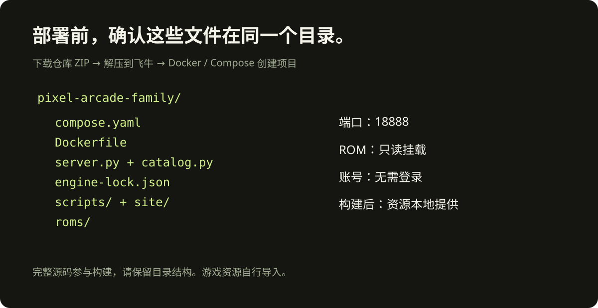
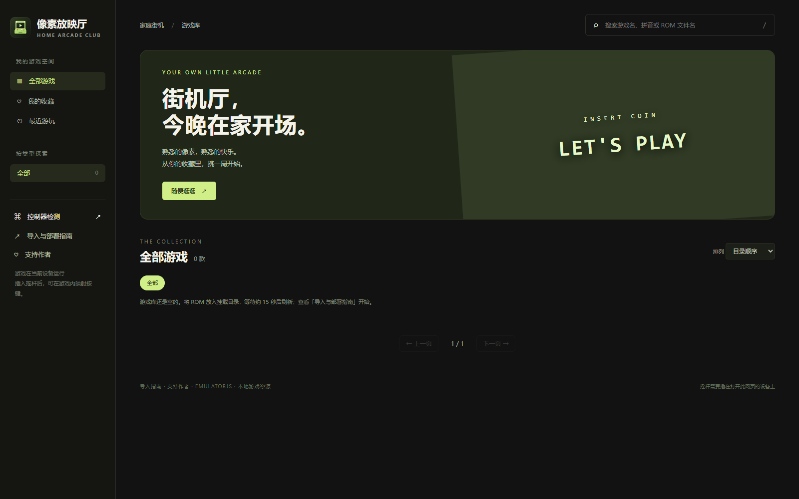
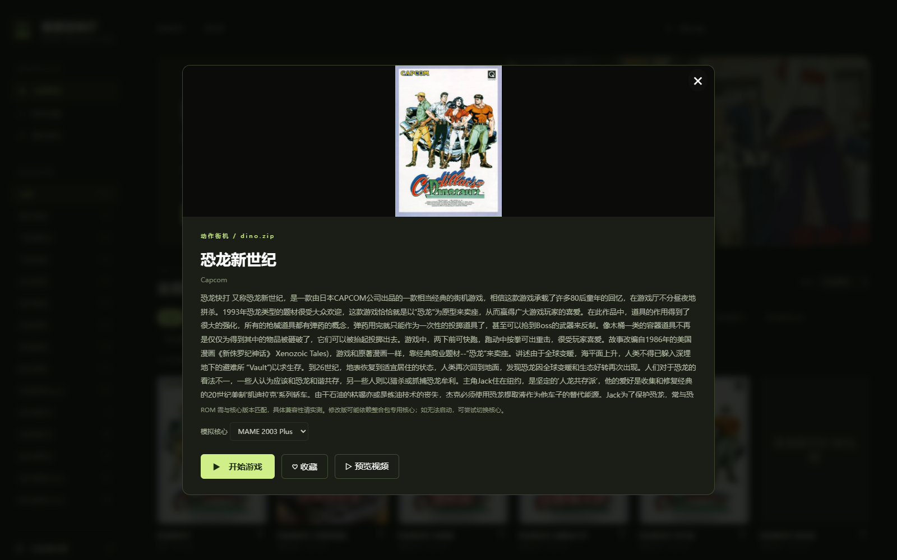

# 飞牛 fnOS 部署教程

## 1. 下载项目

打开 [GitHub 仓库](https://github.com/infinitytom/pixel-arcade-family)，点击 **Code → Download ZIP**，解压到飞牛上的一个独立文件夹，例如 `我的文件/pixel-arcade-family`。

目录中应直接看到 `compose.yaml`、`Dockerfile`、`server.py`、`catalog.py`、`engine-lock.json`、`scripts` 和 `site`。不要只复制 Compose 文件，构建需要这些源码。



## 2. 放入 ROM

在项目目录下创建 `roms` 文件夹，把自己的游戏放进去。外层整合包先解压；游戏本身的 ZIP 保持原样。完整资源包中的 `gamelist.xml`、各分类、封面和视频目录需要保持相对位置。

已有游戏目录时，不必重复复制：复制 `.env.example` 为 `.env`，将 `ROM_DIR` 设置为目录的绝对路径。例如：

```dotenv
ARCADE_PORT=18888
ROM_DIR=/vol2/1000/games/fbneo
DEFAULT_CORE=fbneo
```

飞牛存储卷编号与用户目录因机器而异，请在文件管理中获取实际路径。项目以 UID/GID 10001 运行，需要目录读取与遍历权限；出现空目录或 403/404 时先检查权限。

## 3. 创建 Compose 项目

在飞牛 **Docker → Compose** 中创建项目，项目名可填 `pixel-arcade-family`，选择上述文件夹和其中的 `compose.yaml`。不同版本的界面措辞可能略有差异，关键是工作目录必须是项目根目录。

选择构建并启动。首次构建会拉取 `python:3.12-alpine`，并下载官方 npm 中的模拟器及四个核心，需确保飞牛能访问 Docker Hub 和 `registry.npmjs.org`。构建日志出现 `Engine ready` 后会继续生成最终镜像。

如果界面未自动构建，SSH 进入项目目录执行：

```sh
docker compose up -d --build
docker compose ps
docker compose logs --tail=80
```



## 4. 打开游戏大厅

在同一家庭网络内，用浏览器打开 `http://你的飞牛IP:18888`。例如飞牛地址是 `192.168.1.20`，就打开 `http://192.168.1.20:18888`。这只是示例 IP，请换成自己的地址。

18888 已占用时，在 `.env` 将 `ARCADE_PORT` 改为其他空闲端口，例如 18891，然后重新启动项目。访问地址也需要改用相应端口。


图中游戏来自作者本地收藏，仅展示导入效果；首次部署为空库，项目不内置这些游戏和封面。

## 5. 开始一局

搜索或选择分类 → 点击游戏 → 选择核心 → 开始游戏 → 在模拟器中点击启动。ROM 与核心不匹配时可以返回详情切换核心再尝试。不能用整理包数量代替兼容性实测。



在模拟器控制设置中确认投币、开始和攻击按键。摇杆插到打开网页的电脑或电视上；大厅左侧的「控制器检测」可查看输入。HTTP 下部分浏览器无法使用 USB Gamepad API，需要自行配置可信 HTTPS。键盘型摇杆可先按键盘方式检测。

## 6. 存档与更新

收藏、最近游玩和存档在当前浏览器。换浏览器、换设备不会自动同步。通过模拟器菜单导出存档后再清理浏览器数据。

新增游戏等待约 15 秒后刷新大厅即可。更新程序前备份 `.env`、`roms` 与导出存档，然后在项目目录拉取新源码并重新构建。停止或删除容器不会自动删除挂载的游戏文件。

## 安装范围

此教程针对独立安装。若你此前已有同名服务或端口占用，使用不同项目名和空闲端口。家庭版无账号鉴权，只部署在可信家庭网络；公网使用需要额外的访问控制。
